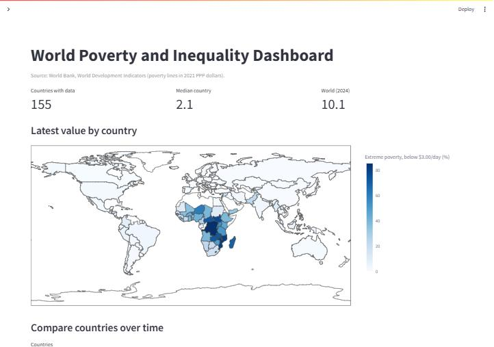
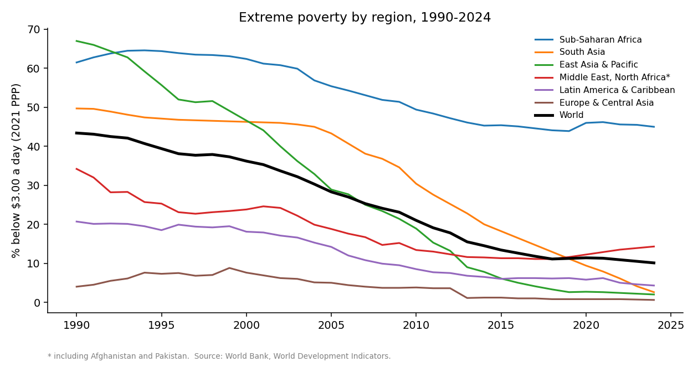
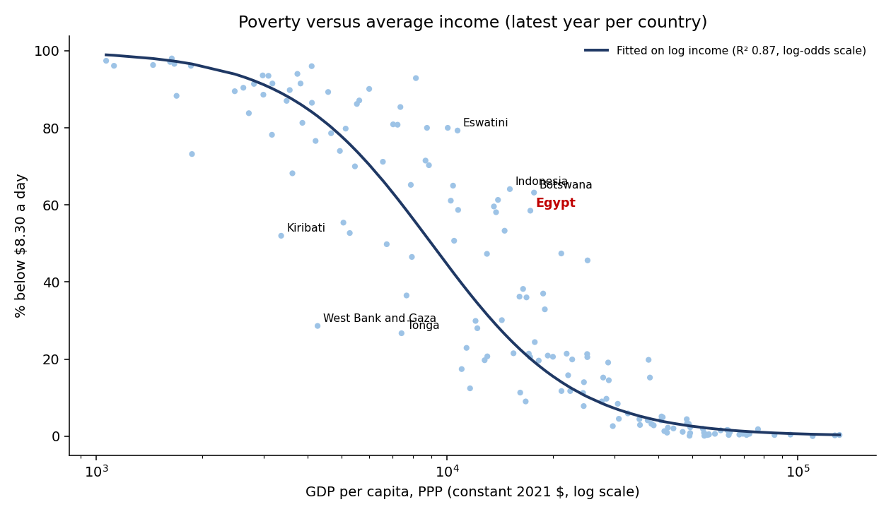
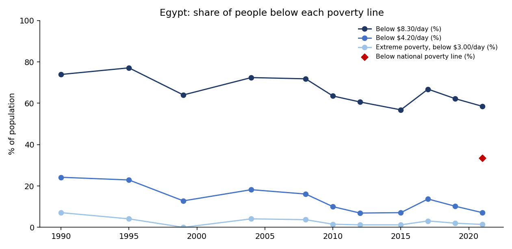
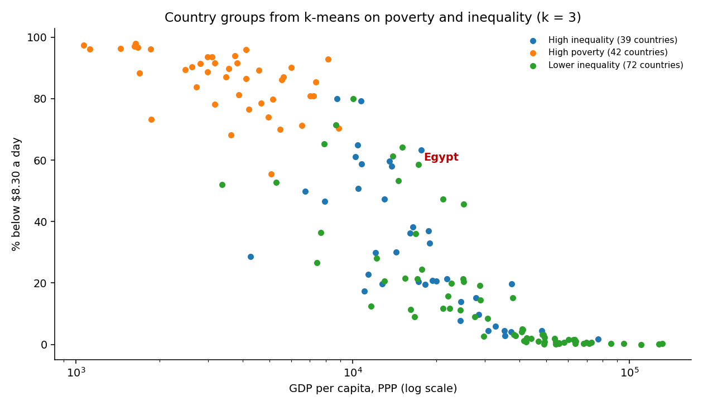

# Global Poverty and Inequality Analysis (World Bank Data)

[](https://github.com/ZIADAYMAN81/world-bank-poverty-analysis/actions/workflows/tests.yml)

> Data Science coursework, The British University in Egypt, 2024 (rebuilt in 2026 with the latest World Bank data). Author: Ziad Ayman.

An end-to-end data analysis of poverty and inequality across **217 countries from 1990 to 2024**, built on live data from the **World Bank API**. It covers a reproducible data pipeline, regional trends, a statistical model of poverty versus income, country segmentation with k-means, an Egypt case study and an **interactive Streamlit dashboard**.



## Key findings

**1. Extreme poverty has fallen by three-quarters since 1990, but not everywhere.** The world share of people living on less than $3.00 a day fell from 43.4% in 1990 to 10.1% in 2024. East Asia (67.0% → 2.0%) and South Asia (49.7% → 2.6%) drove the decline. Sub-Saharan Africa barely moved after 2015 (45.4% → 45.0%), and the Middle East and North Africa region is the only one where extreme poverty has *risen* since 2019 (11.6% → 14.3%).



**2. Average income explains most, but not all, of a country's poverty.** Modelling each country's share below $8.30 a day on log GDP per capita explains 87% of the variation (log-odds scale, 153 countries; Spearman ρ = −0.95). Countries above the curve have more poverty than their income predicts. That excess is mildly associated with higher inequality (ρ = 0.19, p = 0.02), so how growth is shared matters as well as how much there is.



**3. Egypt has the 3rd-largest "excess poverty" of 153 countries.** In 2021, 58.5% of Egyptians lived below $8.30 a day, against about 20% predicted from Egypt's GDP per capita. Only Botswana and Indonesia deviate more. Inequality in Egypt is *low* by global standards (Gini 28.5), and extreme poverty is rare (1.4% below $3.00), so the gap reflects a large share of people living just above the lowest lines rather than deep destitution. The national poverty line puts 33.5% of Egyptians below it.



**4. Countries fall into three distinct profiles.** K-means on five standardised indicators (k = 3 chosen by silhouette score):

| Group | Countries | Median below $8.30/day | Median Gini | Median GDP per capita | Typical members |
|---|---|---|---|---|---|
| Lower inequality | 72 | 4.5% | 31.3 | $38,510 | Europe, East Asia, Egypt, India |
| High inequality | 39 | 22.9% | 42.4 | $17,246 | Latin America, South Africa, United States |
| High poverty | 42 | 88.4% | 36.5 | $3,682 | Mostly Sub-Saharan Africa |



## Pipeline
1. **Data collection** (`wb/data.py`): downloads 8 World Development Indicators for every country and regional aggregate from the public World Bank API, with retries and a local CSV cache for reproducible offline runs.
2. **Cleaning:** a tidy country-year panel joined to region and income-group metadata; aggregates kept separate from countries; country names normalised.
3. **Analysis** (`wb/analysis.py`): latest-survey selection per country, the World Bank's own population-weighted regional series, a log-odds regression of poverty on income with residual analysis, and k-means segmentation.
4. **Reporting** (`wb/report.py`): every chart above plus `summary.json` and CSV tables, regenerated with one command.
5. **Dashboard** (`dashboard/app.py`): a choropleth map, country comparisons and cluster tables for any indicator and survey window.

## Getting started
```bash
pip install -r requirements.txt
python -m wb.report              # downloads data (first run), writes charts and tables to reports/
python -m wb.report --refresh    # pull the latest World Bank release
streamlit run dashboard/app.py   # interactive dashboard
python -m pytest -q              # includes an automated run of the dashboard
```

## Notes and limitations
- Poverty figures come from household surveys run every few years, so each country's latest value may come from a different year (2014 or later). GDP per capita is also the latest available.
- Poverty lines are in 2021 purchasing-power-parity dollars, following the World Bank's 2025 update ($3.00, $4.20 and $8.30 a day).
- The income model shows association, not causation.

## Tech stack
Python · pandas · NumPy · scikit-learn · SciPy · matplotlib · Plotly · Streamlit · World Bank API · pytest

## License
MIT, see [LICENSE](LICENSE).
